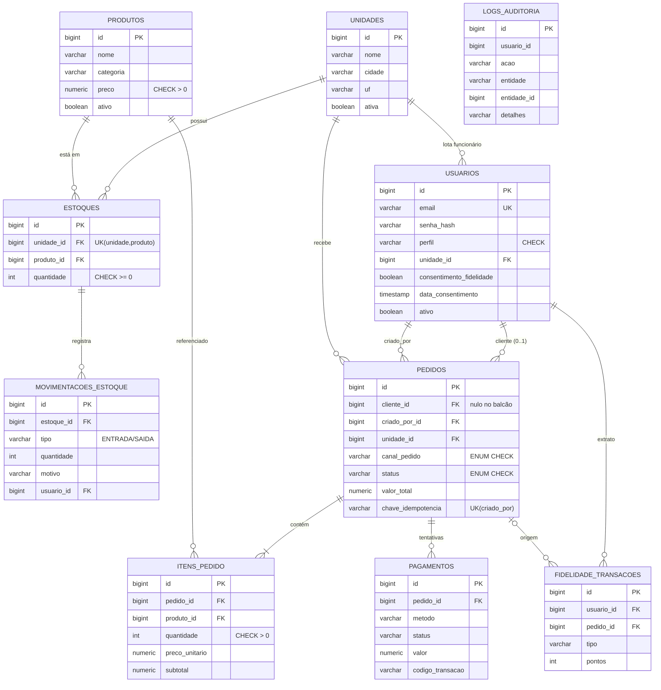
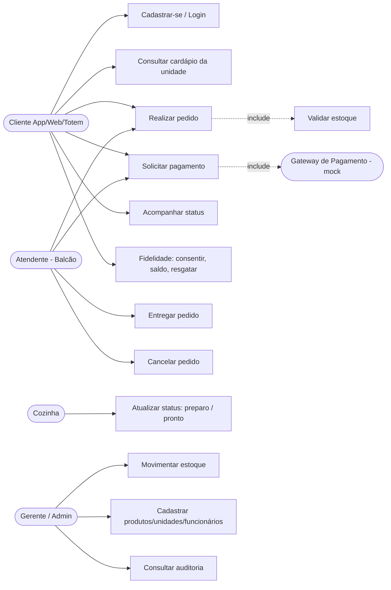
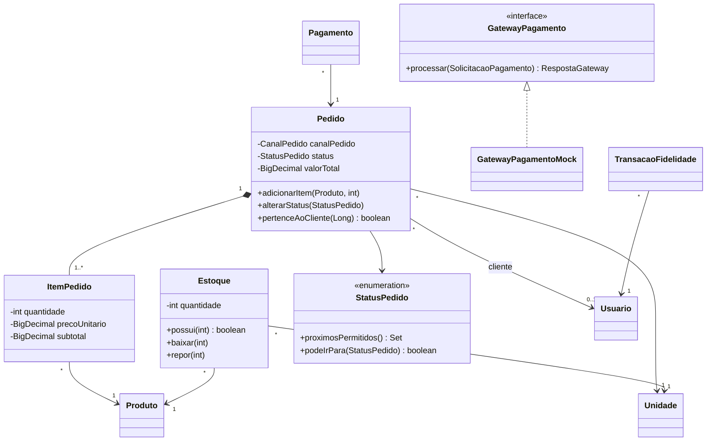

# Diagramas — Raízes do Nordeste

Diagramas em Mermaid (renderizam no GitHub). Para o PDF, exporte em https://mermaid.live.

## DER (espelha `V1__criar_tabelas.sql`)



## Casos de uso



## Classes de domínio



## Sequência do fluxo crítico

```mermaid
sequenceDiagram
    actor Cliente
    participant API as PedidoController / PagamentoController
    participant PS as PedidoService
    participant PG as PagamentoService
    participant GW as GatewayPagamentoMock
    participant DB as Banco

    Cliente->>API: POST /pedidos (JWT, canalPedido, itens)
    API->>PS: criar()
    PS->>DB: valida unidade/produtos, lock no estoque
    alt estoque insuficiente
        PS-->>Cliente: 409 ESTOQUE_INSUFICIENTE
    else ok
        PS->>DB: grava pedido AGUARDANDO_PAGAMENTO, reserva estoque, auditoria
        PS-->>Cliente: 201 pedido
    end
    Cliente->>API: POST /pagamentos
    API->>PG: pagar()
    PG->>GW: processar(valor, método, token)
    alt aprovado
        PG->>DB: pagamento APROVADO, pedido PAGO, pontos, auditoria
        PG-->>Cliente: 201 APROVADO
    else recusado
        PG->>DB: pagamento RECUSADO, auditoria
        PG-->>Cliente: 402 PAGAMENTO_RECUSADO
    else gateway fora (3 tentativas)
        PG->>DB: pagamento ERRO
        PG-->>Cliente: 503 GATEWAY_INDISPONIVEL
    end
    Note over API,DB: Cozinha: PATCH status EM_PREPARACAO → PRONTO; Atendente: ENTREGUE
```
